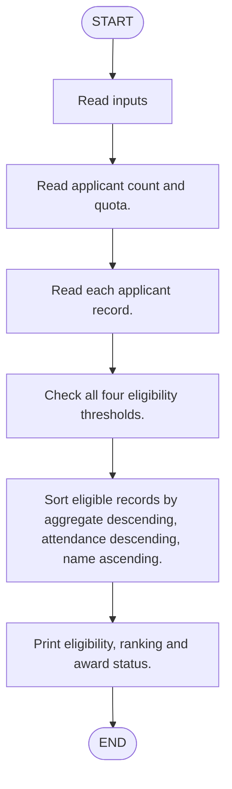
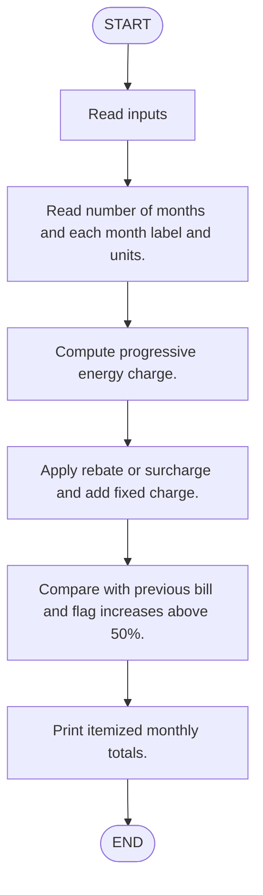
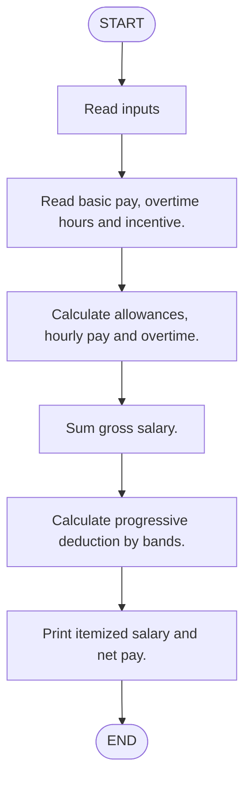
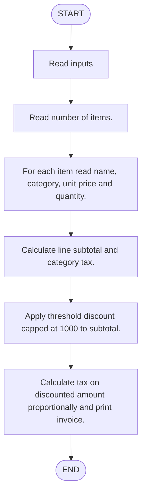
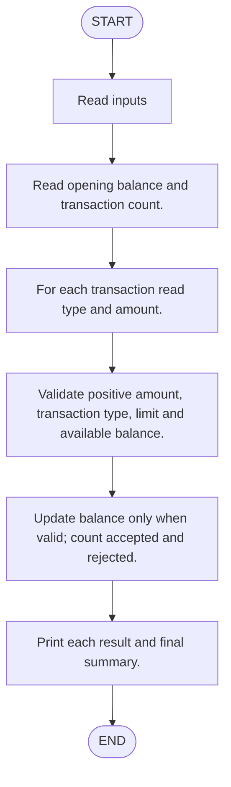
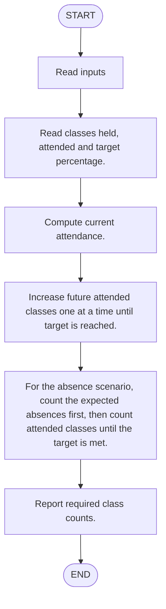
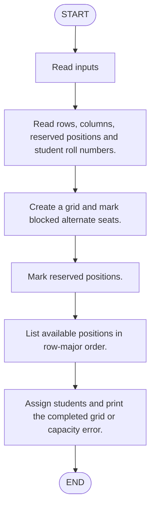
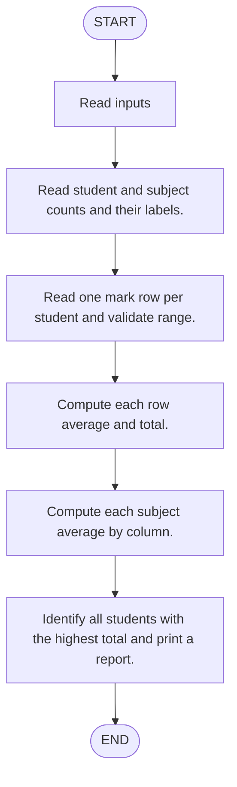
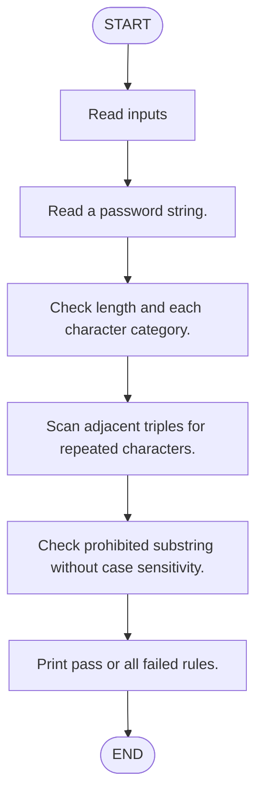
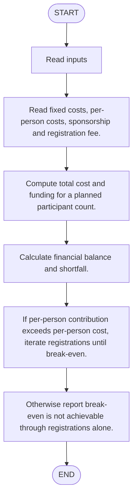

# Python Activity-Based Learning - Case Study Deliverables

**Student:** Miyyapuram Vignesh  
**NIAT ID:** N26V01A0197  
**NRI ID:** 26000633

This repository contains the non-PDF materials. Test output images are generated from actual local runs of the Python programs; they are not captures of an online compiler.


---

# Case 1: University Scholarship Allocation

**Topics:** Conditionals, lists, loops, ranking and tie-breaking

## Problem statement
Evaluate applicants for a merit scholarship using marks, attendance, family income and a subject minimum. Rank eligible students and award a limited number of scholarships.

## Objectives
Apply multiple eligibility conditions; process records with a loop; sort eligible candidates deterministically.

## Assumptions
Each applicant is entered as name, aggregate percentage, minimum subject mark, attendance percentage and annual family income. Eligibility requires aggregate >= 80, subject mark >= 60, attendance >= 75 and income <= 300000. Rank by aggregate, then attendance, then name. Quota is entered.

## Algorithm
1. Read applicant count and quota.
2. Read each applicant record.
3. Check all four eligibility thresholds.
4. Sort eligible records by aggregate descending, attendance descending, name ascending.
5. Print eligibility, ranking and award status.

## Vertical flowchart


## Pseudocode
```text
INPUT n, quota
eligible = []
FOR each applicant
  INPUT name, aggregate, subject, attendance, income
  IF aggregate >= 80 AND subject >= 60 AND attendance >= 75 AND income <= 300000
    ADD applicant TO eligible
SORT eligible by aggregate desc, attendance desc, name asc
FOR each applicant
  PRINT rank and scholarship decision
```

## Python source
```python
n = int(input("Number of applicants: "))
quota = int(input("Scholarship quota: "))
eligible = []
for _ in range(n):
    name = input("Name: ")
    aggregate = float(input("Aggregate (%): "))
    subject = float(input("Minimum subject mark (%): "))
    attendance = float(input("Attendance (%): "))
    income = float(input("Annual family income: "))
    qualified = aggregate >= 80 and subject >= 60 and attendance >= 75 and income <= 300000
    if qualified:
        eligible.append((name, aggregate, attendance))
eligible.sort(key=lambda item: (-item[1], -item[2], item[0].lower()))
print("\nEligible candidates (ranked):")
if not eligible:
    print("No eligible candidates")
for rank, item in enumerate(eligible, 1):
    name, aggregate, attendance = item
    award = "AWARDED" if rank <= quota else "WAITLIST"
    print(f"{rank}. {name} | {aggregate:.1f}% | attendance {attendance:.1f}% | {award}")
```

## Test cases

### Test 1: 3 applicants, quota 2; Asha 91,70,90,250000; Bala 85,65,80,280000; Charan 79,80,95,200000
- Input: `3 / 2 / Asha / 91 / 70 / 90 / 250000 / Bala / 85 / 65 / 80 / 280000 / Charan / 79 / 80 / 95 / 200000`
- Expected result: Asha ranked 1 and awarded; Bala ranked 2 and awarded; Charan excluded.
- Run capture: `../output_screenshots/case_01_test_1.png`

### Test 2: 1 applicant; Deepa 88,60,75,300000; quota 1
- Input: `1 / 1 / Deepa / 88 / 60 / 75 / 300000`
- Expected result: Deepa is eligible at all inclusive boundaries and awarded.
- Run capture: `../output_screenshots/case_01_test_2.png`

### Test 3: 1 applicant; Eshan 90,59,95,100000; quota 1
- Input: `1 / 1 / Eshan / 90 / 59 / 95 / 100000`
- Expected result: No eligible candidates (subject minimum is not met).
- Run capture: `../output_screenshots/case_01_test_3.png`

## Conclusion
The program applies conjunctive eligibility checks and produces a repeatable merit order. Inclusive boundary checks ensure applicants exactly at a stated minimum remain eligible.


---

# Case 2: Progressive Electricity Billing

**Topics:** Arithmetic, slab conditions, comparisons and loops

## Problem statement
Calculate residential electricity bills for multiple months using progressive unit slabs, a fixed charge, a surcharge above a threshold and a rebate below a low-use threshold.

## Objectives
Use ordered slab calculations; compute adjustments; compare monthly bills for unusual increases.

## Assumptions
Slab rates are 0-100 units at 2.00/unit, next 100 at 3.00/unit, above 200 at 5.00/unit. Fixed charge is 50. A 10% surcharge applies to energy charge above 500 units; a 5% rebate on energy applies at <= 50 units. An increase above 50% from the previous month is flagged.

## Algorithm
1. Read number of months and each month label and units.
2. Compute progressive energy charge.
3. Apply rebate or surcharge and add fixed charge.
4. Compare with previous bill and flag increases above 50%.
5. Print itemized monthly totals.

## Vertical flowchart


## Pseudocode
```text
FOR each month
  energy = slab_charge(units)
  IF units <= 50: adjustment = -5% of energy
  ELSE IF energy > 500: adjustment = 10% of energy
  ELSE: adjustment = 0
  bill = energy + adjustment + 50
  IF previous bill exists AND bill > 1.5 * previous: flag increase
  PRINT bill
```

## Python source
```python
n = int(input("Number of months: "))
previous = None
for _ in range(n):
    month = input("Month: ")
    units = float(input("Units consumed: "))
    if units < 0:
        print("Invalid units")
        continue
    first = min(units, 100) * 2
    second = min(max(units - 100, 0), 100) * 3
    third = max(units - 200, 0) * 5
    energy = first + second + third
    if units <= 50:
        adjustment = -0.05 * energy
    elif energy > 500:
        adjustment = 0.10 * energy
    else:
        adjustment = 0
    bill = energy + adjustment + 50
    flag = " | UNUSUAL INCREASE" if previous is not None and bill > 1.5 * previous else ""
    print(f"{month}: energy={energy:.2f}, adjustment={adjustment:.2f}, fixed=50.00, total={bill:.2f}{flag}")
    previous = bill
```

## Test cases

### Test 1: Jan 40 units; Feb 120 units
- Input: `2 / Jan / 40 / Feb / 120`
- Expected result: Jan total 126.00; Feb total 310.00 and is flagged for unusual increase.
- Run capture: `../output_screenshots/case_02_test_1.png`

### Test 2: Jan 100 units; Feb 300 units
- Input: `2 / Jan / 100 / Feb / 300`
- Expected result: Jan total 250.00; Feb total 1150.00, flagged unusual increase.
- Run capture: `../output_screenshots/case_02_test_2.png`

### Test 3: Mar 0 units
- Input: `1 / Mar / 0`
- Expected result: Energy 0.00, total bill 50.00.
- Run capture: `../output_screenshots/case_02_test_3.png`

## Conclusion
The solution separates slab portions before applying adjustments, preventing a single rate from being incorrectly applied to all units.


---

# Case 3: Employee Payroll and Deduction Analysis

**Topics:** Variables, arithmetic, conditions, formatted output

## Problem statement
Prepare a salary statement from basic pay, allowances, overtime and incentives, then apply progressive deductions and report take-home pay.

## Objectives
Calculate gross salary; apply progressive deductions; format a readable statement.

## Assumptions
HRA is 20% and transport allowance is 10% of basic pay. Overtime is paid at 1.5 times the hourly basic rate for a 160-hour month. Incentive is entered directly. Deduction is 5% on the first 20000 of gross, 10% on the next 20000 and 20% above 40000.

## Algorithm
1. Read basic pay, overtime hours and incentive.
2. Calculate allowances, hourly pay and overtime.
3. Sum gross salary.
4. Calculate progressive deduction by bands.
5. Print itemized salary and net pay.

## Vertical flowchart


## Pseudocode
```text
READ basic, overtime_hours, incentive
HRA = 0.20 * basic; transport = 0.10 * basic
overtime = (basic / 160) * 1.5 * overtime_hours
gross = basic + HRA + transport + overtime + incentive
deduction = 5% first 20000 + 10% next 20000 + 20% remaining
net = gross - deduction
PRINT salary statement
```

## Python source
```python
basic = float(input("Basic pay: "))
hours = float(input("Overtime hours: "))
incentive = float(input("Incentive: "))
if basic < 0 or hours < 0 or incentive < 0:
    print("Invalid input: values must be non-negative")
else:
    hra = 0.20 * basic
    transport = 0.10 * basic
    overtime = (basic / 160) * 1.5 * hours
    gross = basic + hra + transport + overtime + incentive
    deduction = min(gross, 20000) * 0.05
    deduction += min(max(gross - 20000, 0), 20000) * 0.10
    deduction += max(gross - 40000, 0) * 0.20
    print("\nSALARY STATEMENT")
    print(f"Basic: {basic:.2f} | HRA: {hra:.2f} | Transport: {transport:.2f}")
    print(f"Overtime: {overtime:.2f} | Incentive: {incentive:.2f}")
    print(f"Gross: {gross:.2f} | Deduction: {deduction:.2f} | Net: {gross-deduction:.2f}")
```

## Test cases

### Test 1: Basic 30000, overtime 10 hours, incentive 2000
- Input: `30000 / 10 / 2000`
- Expected result: Gross 43812.50; deduction 3762.50; net 40050.00.
- Run capture: `../output_screenshots/case_03_test_1.png`

### Test 2: Basic 0, overtime 0, incentive 0
- Input: `0 / 0 / 0`
- Expected result: Gross, deduction and net are all 0.00.
- Run capture: `../output_screenshots/case_03_test_2.png`

### Test 3: Negative basic pay
- Input: `-1 / 0 / 0`
- Expected result: Invalid input message.
- Run capture: `../output_screenshots/case_03_test_3.png`

## Conclusion
The program calculates each earning separately and applies deduction bands progressively, making the final take-home amount easy to audit.


---

# Case 4: Retail Billing with Multiple Discount Rules

**Topics:** Lists, loops, category rules and totals

## Problem statement
Create an itemized retail invoice for products, quantities and categories, applying category-specific tax and a threshold discount with a maximum concession.

## Objectives
Process repeated product records; use category decisions; calculate a capped invoice discount.

## Assumptions
Categories E (electronics) and G (grocery) have taxes 18% and 5%. Subtotal discount is 10% when subtotal >= 5000, capped at 1000. Tax is calculated after discount and allocated proportionally across items for invoice simplicity. Inputs are non-negative and categories must be E or G.

## Algorithm
1. Read number of items.
2. For each item read name, category, unit price and quantity.
3. Calculate line subtotal and category tax.
4. Apply threshold discount capped at 1000 to subtotal.
5. Calculate tax on discounted amount proportionally and print invoice.

## Vertical flowchart


## Pseudocode
```text
subtotal = 0
FOR each item: read name, category, price, qty; line = price * qty; store item; subtotal += line
discount = min(10% of subtotal, 1000) IF subtotal >= 5000 ELSE 0
FOR each item: allocate discount proportionally; compute category tax
PRINT itemized lines, subtotal, discount, tax, total
```

## Python source
```python
n = int(input("Number of products: "))
items = []
subtotal = 0.0
for _ in range(n):
    name = input("Product: ")
    category = input("Category (E/G): ").upper()
    price = float(input("Unit price: "))
    quantity = int(input("Quantity: "))
    if category not in ("E", "G") or price < 0 or quantity < 0:
        print("Invalid product record")
        continue
    line = price * quantity
    items.append((name, category, price, quantity, line))
    subtotal += line
discount = min(subtotal * 0.10, 1000) if subtotal >= 5000 else 0
tax_total = 0.0
print("\nITEMIZED INVOICE")
for name, category, price, quantity, line in items:
    share = (line / subtotal * discount) if subtotal else 0
    taxable = line - share
    tax = taxable * (0.18 if category == "E" else 0.05)
    tax_total += tax
    print(f"{name}: {quantity} x {price:.2f} = {line:.2f}; discount {share:.2f}; tax {tax:.2f}")
print(f"Subtotal: {subtotal:.2f} | Discount: {discount:.2f} | Tax: {tax_total:.2f} | Total: {subtotal-discount+tax_total:.2f}")
```

## Test cases

### Test 1: Phone E 10000 x1; Rice G 100 x2
- Input: `2 / Phone / E / 10000 / 1 / Rice / G / 100 / 2`
- Expected result: Subtotal 10200.00; discount 1000.00; tax 1632.53; total 10832.53 (rounded).
- Run capture: `../output_screenshots/case_04_test_1.png`

### Test 2: Rice G 100 x2
- Input: `1 / Rice / G / 100 / 2`
- Expected result: Subtotal 200.00; no discount; tax 10.00; total 210.00.
- Run capture: `../output_screenshots/case_04_test_2.png`

### Test 3: One product, price 5000, qty 1, category E
- Input: `1 / Laptop / E / 5000 / 1`
- Expected result: Discount 500.00, tax 810.00, total 5310.00.
- Run capture: `../output_screenshots/case_04_test_3.png`

## Conclusion
The invoice supports multiple products and category taxes while enforcing the maximum discount. The proportional allocation makes discounted taxable line amounts sum to the discounted subtotal.


---

# Case 5: ATM Transaction Sequence Simulation

**Topics:** Loops, lists, conditions and transaction summaries

## Problem statement
Simulate a sequence of deposits and withdrawals, preserve a running balance, enforce a per-withdrawal limit and reject invalid transactions.

## Objectives
Maintain state over a sequence; validate operations; summarize accepted and rejected transactions.

## Assumptions
Starting balance and transaction amounts are non-negative. Withdrawal limit is 10000 per transaction. Withdrawals cannot exceed balance. Types are D for deposit and W for withdrawal. Invalid entries do not change balance.

## Algorithm
1. Read opening balance and transaction count.
2. For each transaction read type and amount.
3. Validate positive amount, transaction type, limit and available balance.
4. Update balance only when valid; count accepted and rejected.
5. Print each result and final summary.

## Vertical flowchart


## Pseudocode
```text
READ balance, n
accepted = rejected = 0
FOR each transaction
  READ type, amount
  IF amount <= 0: reject
  ELSE IF type == D: balance += amount; accept
  ELSE IF type == W AND amount <= 10000 AND amount <= balance: balance -= amount; accept
  ELSE: reject
  PRINT status and balance
PRINT summary
```

## Python source
```python
balance = float(input("Opening balance: "))
n = int(input("Number of transactions: "))
accepted = rejected = 0
for _ in range(n):
    kind = input("Transaction (D/W): ").upper()
    amount = float(input("Amount: "))
    if amount <= 0:
        ok = False
    elif kind == "D":
        balance += amount
        ok = True
    elif kind == "W" and amount <= 10000 and amount <= balance:
        balance -= amount
        ok = True
    else:
        ok = False
    if ok:
        accepted += 1
        print(f"Accepted. Balance: {balance:.2f}")
    else:
        rejected += 1
        print(f"Rejected. Balance unchanged: {balance:.2f}")
print(f"Summary: accepted={accepted}, rejected={rejected}, final balance={balance:.2f}")
```

## Test cases

### Test 1: Opening 5000; deposit 2000; withdraw 3000
- Input: `5000 / 2 / D / 2000 / W / 3000`
- Expected result: Both accepted; final balance 4000.00.
- Run capture: `../output_screenshots/case_05_test_1.png`

### Test 2: Opening 500; withdraw 600
- Input: `500 / 1 / W / 600`
- Expected result: Rejected for insufficient funds; balance 500.00.
- Run capture: `../output_screenshots/case_05_test_2.png`

### Test 3: Opening 20000; withdraw 10001
- Input: `20000 / 1 / W / 10001`
- Expected result: Rejected for exceeding per-transaction limit.
- Run capture: `../output_screenshots/case_05_test_3.png`

## Conclusion
Running balance changes only after a valid transaction. The sequence summary gives a clear audit trail for the simulated account.


---

# Case 6: Attendance Recovery Computation

**Topics:** Loops, arithmetic and scenario comparisons

## Problem statement
Calculate current attendance percentage and the minimum consecutive classes a student must attend to reach a required threshold.

## Objectives
Translate a percentage target into an iterative calculation; compare attendance scenarios.

## Assumptions
Classes held is positive, attended classes are between zero and held classes, target is between 0 and 100. Future classes are assumed attended consecutively. A separate scenario allows a fixed number of future absences before the target can be met.

## Algorithm
1. Read classes held, attended and target percentage.
2. Compute current attendance.
3. Increase future attended classes one at a time until target is reached.
4. For the absence scenario, count the expected absences first, then count attended classes until the target is met.
5. Report required class counts.

## Vertical flowchart


## Pseudocode
```text
READ held, attended, target, future_absences
current = attended / held * 100
need = 0
WHILE (attended + need) / (held + need) * 100 < target: need += 1
scenario_total = 0; a=attended; h=held
WHILE a / h * 100 < target: scenario_total += 1; h += 1; IF scenario_total > future_absences: a += 1
PRINT current, need, scenario_total
```

## Python source
```python
held = int(input("Classes held: "))
attended = int(input("Classes attended: "))
target = float(input("Required attendance (%): "))
absences = int(input("Expected absences before attending: "))
if held <= 0 or attended < 0 or attended > held or not 0 <= target <= 100 or absences < 0:
    print("Invalid attendance data")
else:
    current = attended / held * 100
    need = 0
    while (attended + need) / (held + need) * 100 < target:
        need += 1
    scenario_total = 0
    a, h = attended, held
    while a / h * 100 < target:
        scenario_total += 1
        h += 1
        if scenario_total > absences:
            a += 1
    print(f"Current attendance: {current:.2f}%")
    print(f"Consecutive classes to attend: {need}")
    print(f"Total future classes including {absences} expected absence(s): {scenario_total}")
```

## Test cases

### Test 1: Held 60, attended 42, target 75%, no future absences
- Input: `60 / 42 / 75 / 0`
- Expected result: Current 70.00%; attend 12 consecutive classes to reach 75%.
- Run capture: `../output_screenshots/case_06_test_1.png`

### Test 2: Held 10, attended 10, target 75%, no absences
- Input: `10 / 10 / 75 / 0`
- Expected result: Current 100.00%; 0 classes required.
- Run capture: `../output_screenshots/case_06_test_2.png`

### Test 3: Held 20, attended 10, target 75%, expect 2 absences first
- Input: `20 / 10 / 75 / 2`
- Expected result: Current 50.00%; 26 classes attended are needed; 28 total future classes including the two absences.
- Run capture: `../output_screenshots/case_06_test_3.png`

## Conclusion
The loop finds the smallest integer number of future classes that satisfies the target exactly, avoiding rounding errors in the decision.


---

# Case 7: Nested Loop Examination Seating Generator

**Topics:** Nested loops, patterns, lists and capacity validation

## Problem statement
Generate a classroom seating grid with row and column identifiers, reserved positions and alternating-seat restrictions.

## Objectives
Generate a two-dimensional layout using nested loops; preserve reserved locations; validate capacity.

## Assumptions
Rows and columns are positive. Seats where row+column is even are blocked under the alternate seating rule. Reserved seats are specified as row,column pairs using one-based indexing and remain marked RESERVED even if blocked. Students are assigned sequentially to remaining seats row-wise. The requested student count cannot exceed available seats.

## Algorithm
1. Read rows, columns, reserved positions and student roll numbers.
2. Create a grid and mark blocked alternate seats.
3. Mark reserved positions.
4. List available positions in row-major order.
5. Assign students and print the completed grid or capacity error.

## Vertical flowchart


## Pseudocode
```text
CREATE grid rows x columns
FOR each cell: IF alternate rule blocks it: mark X
MARK reserved coordinates R
available = all empty cells row-wise
IF students > available: PRINT capacity error
ELSE assign roll numbers to available cells in order
PRINT grid
```

## Python source
```python
rows = int(input("Rows: "))
cols = int(input("Columns: "))
reserved_count = int(input("Reserved seat count: "))
reserved = []
for _ in range(reserved_count):
    r = int(input("Reserved row (1-based): "))
    c = int(input("Reserved column (1-based): "))
    reserved.append((r - 1, c - 1))
students = input("Roll numbers separated by spaces: ").split()
grid = [["." for _ in range(cols)] for _ in range(rows)]
for r in range(rows):
    for c in range(cols):
        if (r + c) % 2 == 0:
            grid[r][c] = "X"
for r, c in reserved:
    if 0 <= r < rows and 0 <= c < cols:
        grid[r][c] = "R"
available = [(r, c) for r in range(rows) for c in range(cols) if grid[r][c] == "."]
if len(students) > len(available):
    print(f"Capacity error: {len(available)} available seats for {len(students)} students")
else:
    for roll, (r, c) in zip(students, available):
        grid[r][c] = roll
    print("Seating grid (X=blocked, R=reserved, .=vacant):")
    for r, line in enumerate(grid, 1):
        print(f"Row {r}: " + " | ".join(line))
    print(f"Assigned: {len(students)} | Vacant allowed seats: {len(available)-len(students)}")
```

## Test cases

### Test 1: 2x3, reserve 1,2; students A1 B2
- Input: `2 / 3 / 1 / 1 / 2 / A1 B2`
- Expected result: A1 assigned to row 2, column 1; B2 to row 2, column 3; 1,2 reserved; no allowed seats remain vacant.
- Run capture: `../output_screenshots/case_07_test_1.png`

### Test 2: 1x2, no reserve; students X Y
- Input: `1 / 2 / 0 / X Y`
- Expected result: Both cells are blocked by alternate restriction; capacity error.
- Run capture: `../output_screenshots/case_07_test_2.png`

### Test 3: 2x2, reserve 1,1; one student A
- Input: `2 / 2 / 1 / 1 / 1 / A`
- Expected result: 1,1 reserved; remaining alternately available seat is 1,2; student assigned.
- Run capture: `../output_screenshots/case_07_test_3.png`

## Conclusion
Nested loops build a predictable row-wise classroom map. Capacity is checked before assignment so the program never silently drops a student.


---

# Case 8: Student Marks Matrix Analysis

**Topics:** Nested lists, row/column calculations and classification

## Problem statement
Analyze a matrix of student marks by calculating student totals and averages, subject averages and the top performer.

## Objectives
Traverse nested lists by row and column; calculate aggregate and subject statistics.

## Assumptions
Every student has marks for the same positive number of subjects. Marks are from 0 to 100. Student and subject labels are entered as space-separated strings. Ties for top performer are reported.

## Algorithm
1. Read student and subject counts and their labels.
2. Read one mark row per student and validate range.
3. Compute each row average and total.
4. Compute each subject average by column.
5. Identify all students with the highest total and print a report.

## Vertical flowchart


## Pseudocode
```text
READ student_count, subject_count, names, subjects
FOR each student: READ subject marks; store row
FOR each row: calculate sum and average
FOR each column: calculate subject average
max_total = maximum row sum
PRINT students whose total equals max_total; PRINT column averages
```

## Python source
```python
student_count = int(input("Number of students: "))
subject_count = int(input("Number of subjects: "))
students = input("Student names: ").split()
subjects = input("Subject names: ").split()
marks = []
for i in range(student_count):
    row = [float(x) for x in input(f"Marks for {students[i]}: ").split()]
    if len(row) != subject_count or any(x < 0 or x > 100 for x in row):
        print("Invalid marks row")
        raise SystemExit
    marks.append(row)
totals = [sum(row) for row in marks]
print("\nStudent results:")
for i in range(student_count):
    print(f"{students[i]}: total={totals[i]:.1f}, average={totals[i]/subject_count:.2f}")
print("Subject averages:")
for j in range(subject_count):
    average = sum(marks[i][j] for i in range(student_count)) / student_count
    print(f"{subjects[j]}: {average:.2f}")
top = max(totals)
print("Top performer(s): " + ", ".join(students[i] for i in range(student_count) if totals[i] == top))
```

## Test cases

### Test 1: Asha and Bala; Math Science; marks 80 90 and 85 75
- Input: `2 / 2 / Asha Bala / Math Science / 80 90 / 85 75`
- Expected result: Asha total 170; Bala 160; Math avg 82.50; Science avg 82.50; Asha top.
- Run capture: `../output_screenshots/case_08_test_1.png`

### Test 2: One student, one subject, mark 100
- Input: `1 / 1 / Chetan / Python / 100`
- Expected result: Total 100; average 100; Python average 100; Chetan top.
- Run capture: `../output_screenshots/case_08_test_2.png`

### Test 3: Mark 101
- Input: `1 / 1 / Devi / Math / 101`
- Expected result: Invalid marks row.
- Run capture: `../output_screenshots/case_08_test_3.png`

## Conclusion
The matrix representation supports both student-wise and subject-wise analysis, and tie handling ensures every highest-scoring student is named.


---

# Case 9: Password Policy Validation Engine

**Topics:** Strings, loops, conditions and explanations

## Problem statement
Evaluate password samples against a stated policy and explain each condition that fails.

## Objectives
Inspect strings with loops; combine Boolean conditions; report actionable validation results.

## Assumptions
Policy requires at least 8 characters, at least one uppercase letter, one lowercase letter, one digit, one special character from !@#$, no three identical consecutive characters, and no case-insensitive occurrence of the word password.

## Algorithm
1. Read a password string.
2. Check length and each character category.
3. Scan adjacent triples for repeated characters.
4. Check prohibited substring without case sensitivity.
5. Print pass or all failed rules.

## Vertical flowchart


## Pseudocode
```text
READ password
failures = []
IF length < 8: add length rule
SCAN chars for upper, lower, digit, allowed special
SCAN each triple for identical chars
IF "password" in lowercase password: add prohibited rule
IF failures empty: print valid ELSE print each failure
```

## Python source
```python
password = input("Password: ")
failures = []
if len(password) < 8:
    failures.append("at least 8 characters")
if not any(ch.isupper() for ch in password):
    failures.append("at least one uppercase letter")
if not any(ch.islower() for ch in password):
    failures.append("at least one lowercase letter")
if not any(ch.isdigit() for ch in password):
    failures.append("at least one digit")
if not any(ch in "!@#$" for ch in password):
    failures.append("at least one special character from !@#$")
if any(password[i] == password[i+1] == password[i+2] for i in range(len(password)-2)):
    failures.append("no three identical consecutive characters")
if "password" in password.lower():
    failures.append("must not contain the word 'password'")
if failures:
    print("Invalid password. Failed rules:")
    for rule in failures:
        print("- " + rule)
else:
    print("Password is valid")
```

## Test cases

### Test 1: Strong: Vignesh#27
- Input: `Vignesh#27`
- Expected result: Password is valid.
- Run capture: `../output_screenshots/case_09_test_1.png`

### Test 2: weak
- Input: `weak`
- Expected result: Reports length, uppercase, digit and special-character failures.
- Run capture: `../output_screenshots/case_09_test_2.png`

### Test 3: AdminPassword123!
- Input: `AdminPassword123!`
- Expected result: Reports prohibited word password.
- Run capture: `../output_screenshots/case_09_test_3.png`

## Conclusion
The validator checks independent rules and reports all failures in one run, helping users correct several issues at once.


---

# Case 10: Campus Event Financial Planning

**Topics:** Arithmetic, loops, break-even calculation and decisions

## Problem statement
Calculate event costs and funding, determine a sponsorship shortfall and find the minimum registration count required to break even.

## Objectives
Sum multiple cost categories; compare funding with expenses; derive a minimum registration target.

## Assumptions
Venue, equipment, catering-per-person, transport and certificate-per-person costs are entered. Sponsorship and registration fee are entered. All costs and fees are non-negative. Required registrations are the smallest integer n satisfying sponsorship + n*fee >= fixed costs + n*per-person costs. If the fee does not exceed per-person cost, break-even may be impossible.

## Algorithm
1. Read fixed costs, per-person costs, sponsorship and registration fee.
2. Compute total cost and funding for a planned participant count.
3. Calculate financial balance and shortfall.
4. If per-person contribution exceeds per-person cost, iterate registrations until break-even.
5. Otherwise report break-even is not achievable through registrations alone.

## Vertical flowchart


## Pseudocode
```text
fixed = venue + equipment + transport
per_person = catering + certificate
planned_cost = fixed + planned * per_person
planned_funds = sponsorship + planned * fee
balance = planned_funds - planned_cost
IF fee <= per_person AND sponsorship < fixed: no break-even via registrations
ELSE find minimum n where sponsorship + n*fee >= fixed + n*per_person
PRINT cost, funds, balance, n
```

## Python source
```python
venue = float(input("Venue cost: "))
equipment = float(input("Equipment cost: "))
transport = float(input("Transport cost: "))
catering = float(input("Catering cost per participant: "))
certificate = float(input("Certificate cost per participant: "))
planned = int(input("Planned participants: "))
sponsorship = float(input("Sponsorship: "))
fee = float(input("Registration fee per participant: "))
values = [venue, equipment, transport, catering, certificate, sponsorship, fee]
if any(x < 0 for x in values) or planned < 0:
    print("Invalid financial input")
else:
    fixed = venue + equipment + transport
    per_person = catering + certificate
    cost = fixed + planned * per_person
    funds = sponsorship + planned * fee
    balance = funds - cost
    print(f"Planned cost: {cost:.2f} | Funds: {funds:.2f} | Balance: {balance:.2f}")
    if fee <= per_person and sponsorship < fixed:
        print("Break-even cannot be reached through registrations alone")
    else:
        count = 0
        while sponsorship + count * fee < fixed + count * per_person:
            count += 1
        print(f"Minimum registrations to break even: {count}")
```

## Test cases

### Test 1: Venue 10000, equipment 2000, transport 1000, catering 300, certificate 50; 40 planned; sponsor 5000; fee 500
- Input: `10000 / 2000 / 1000 / 300 / 50 / 40 / 5000 / 500`
- Expected result: Planned cost 27000; funds 25000; balance -2000; minimum registrations 54.
- Run capture: `../output_screenshots/case_10_test_1.png`

### Test 2: Zero fixed costs and zero planned participants
- Input: `0 / 0 / 0 / 0 / 0 / 0 / 0 / 0`
- Expected result: Planned balance 0; break-even at 0 registrations.
- Run capture: `../output_screenshots/case_10_test_2.png`

### Test 3: Fixed cost 1000; per-person cost 100; sponsor 0; fee 50
- Input: `1000 / 0 / 0 / 60 / 40 / 10 / 0 / 50`
- Expected result: Break-even cannot be reached through registrations alone.
- Run capture: `../output_screenshots/case_10_test_3.png`

## Conclusion
The solution distinguishes fixed and variable costs, making the break-even rule explicit. It also detects cases where each additional registration increases the shortfall.
